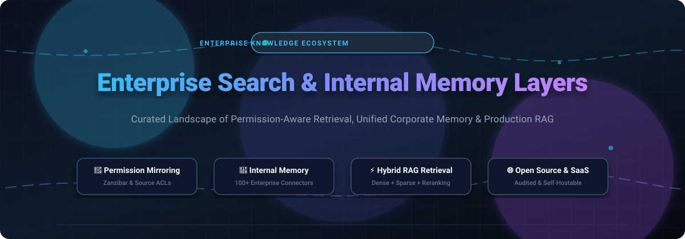

# ⚡ Awesome Enterprise Search &amp; Internal Memory Layers 🧠

  <strong>Curated Directory of Enterprise Search Engines, Workplace Knowledge Assistants, Retrieval-Augmented Generation (RAG) Infrastructure &amp; Internal Memory Layers.</strong>

  <em>Unified Corporate Knowledge • Source-Level Access Control (ACL) Mirroring • Semantic &amp; Hybrid Vector Search • AI Agent Context Management</em>

---

## 📑 Table of Contents
- [📌 Sector Overview &amp; Market Dynamics](#-sector-overview--market-dynamics)
- [🏢 SaaS &amp; Hosted Platforms](#-saas--hosted-platforms)
- [💻 Open-Source GitHub Projects](#-open-source-github-projects)
  - [⭐ Open-Source Ranking by Stars](#-ranked-by-github-stars)
  - [🏗️ Architectural Frameworks &amp; Building Blocks](#️-architectural-frameworks--building-blocks)
- [📈 Star History](#-star-history)
- [🤝 How to Contribute](#-how-to-contribute)
- [💖 Support](#-support)
- [⚠️ Enterprise Security &amp; Disclaimer](#️-enterprise-security--disclaimer)

---

## 📌 Sector Overview &amp; Market Dynamics

The global enterprise search and knowledge retrieval market is valued at approximately **$6.7 Billion in 2026** (projected to exceed $11B+ by the early 2030s at an ~8–11% CAGR). The sector is **structurally fragmented at the connector and infrastructure layer** due to heterogeneous data silos, sovereign data policies, and complex legacy permissions, but is actively **consolidating toward a winner-take-most dynamic at the software layer** driven by capital-intensive LLM inference, Google/Microsoft productivity suite bundling, and category-defining AI platforms.

---

## 🏢 SaaS &amp; Hosted Platforms

The table below catalogs leading commercial Enterprise Search and Workplace Memory solutions, sorted descending by company scale (enterprise market capitalization or private valuation):

| Platform | Valuation / Revenue Scale | Starting Pricing | Free Tier / Trial Limits | Core Focus &amp; Differentiator |
| :--- | :--- | :--- | :--- | :--- |
| **[Amazon Kendra](https://aws.amazon.com/kendra/)** | **~$2.0 Trillion** (Amazon AWS parent market cap) | **$810.00 / month** (Enterprise Edition base) | **30-day free trial** (up to 750 hours on Developer/GenAI Enterprise edition; connectors excluded; sunsetting Dec 31, 2026) | Fully managed AWS enterprise search service with 40+ native connectors. |
| **[Perplexity Enterprise](https://www.perplexity.ai/enterprise)** | **~$23.0 Billion** valuation ($750M+ ARR) | **$40.00 / seat / month** ($34/mo billed annually) | **Permanent free tier** (standard web search with real-time citations, limited daily queries; no free enterprise trial) | Blends live web knowledge with internal team workspace search and SOC 2 data governance. |
| **[Glean](https://www.glean.com/)** | **~$7.2 Billion** valuation ($300M+ ARR) | **~$45.00–$65.00 / seat / month** (typically $50K–$60K annual contract minimum) | **No free tier or public trial** (only paid structured Proof-of-Concept / enterprise pilot engagements) | Industry benchmark enterprise search; 100+ connectors with strict source-system ACL inheritance. |
| **[Hebbia](https://www.hebbia.com/)** | **~$700.0 Million** valuation ($30M–$48M ARR) | **~$3,000.00 / seat / year** (~$250/seat/month on Lite tier) | **No self-serve free tier or public trial** (scoped enterprise pilot programs for qualified institutions only) | AI research Matrix interface for deep simultaneous multi-document analysis in finance and legal. |
| **[Guru](https://www.getguru.com/)** | **~$320.0 Million** ARR estimate ($68M funded) | **$15.00 / user / month** (annual billing) | **30-day free trial** (full access to AI search and verified card workflows; no permanent free tier) | Verified knowledge cards embedded directly into Slack, Teams, and browser workflows. |
| **[Coveo](https://www.coveo.com/)** | **~$300.0 Million** market cap ($148M USD ARR) | **Credit-based usage contracts** (~$1,500+/mo entry commitment) | **No free tier or public trial** (guided enterprise demos and custom POC engagements) | AI-powered relevance engine with Relevance Generative Answering for workplace and support search. |
| **[Qatalog](https://qatalog.com/)** | **~$26.0 Million** prior funding (Acquired by ClickUp) | **$12.00 / user / month** (integrated into ClickUp Brain) | **14-day free trial** (unlimited access during trial window; no permanent free plan) | Autonomous workplace hub unifying project tracking, people directory, and cross-tool search. |
| **[Dashworks](https://www.dashworks.ai/)** | **~$14.5 Million** funding ($1.4M ARR est.) | **$10.00 / seat / month** (billed annually; $12/mo monthly) | **14-day free trial** (no credit card required; no permanent free tier) | Cost-effective Glean alternative featuring 100+ connectors, team search, and Dashworks Answers. |
| **[GoSearch](https://www.gosearch.ai/)** | **Seed/YC-backed** (GoLinks parent entity) | **$20.00 / user / month** (Pro tier) | **Permanent free plan** (10 searches/day, 3 GoAI queries/day, single file uploads, basic connectors) | Multi-modal enterprise search with customizable AI answer personas and GoLinks integration. |
| **[Slite](https://slite.com/)** | **Series A** ($15M funding, Index Ventures) | **$8.00 / user / month** (Standard plan billed annually) | **14-day free trial** (full access with no credit card upfront; no permanent free plan) | Modern team documentation and collaborative knowledge base powered by Ask AI retrieval. |

---

## 💻 Open-Source GitHub Projects

Open-source enterprise search and memory layers are essential for teams demanding zero data leakage, local air-gapped LLM inference, and verifiable source permissions.

### ⭐ Ranked by GitHub Stars

The list below is strictly sorted by GitHub star count (descending):

- **[LangChain](https://github.com/langchain-ai/langchain)**   
  Framework for developing context-aware applications powered by language models, agents, and enterprise retrieval chains.

- **[RAGFlow](https://github.com/infiniflow/ragflow)**   
  Open-source RAG engine based on deep document understanding. DeepDoc parses complex multi-column PDFs, OCR, formulas, and merged tables before multi-path hybrid retrieval.

- **[Elasticsearch](https://github.com/elastic/elasticsearch)**   
  Distributed, RESTful search and analytics engine with dense vector search, lexical BM25 matching, and reciprocal rank fusion (RRF).

- **[Mem0](https://github.com/mem0ai/mem0)**   
  Self-improving personalized and long-term memory layer for AI agents, enterprise search assistants, and multi-tenant applications.

- **[AnythingLLM](https://github.com/Mintplex-Labs/anything-llm)**   
  All-in-one desktop and enterprise-ready AI application featuring granular workspace permissions, document chat, multi-LLM support, and vector store connectors.

- **[Meilisearch](https://github.com/meilisearch/meilisearch)**   
  Ultra-fast, typo-tolerant open-source search engine designed for instant search-as-you-type frontends and internal knowledge portals.

- **[LlamaIndex](https://github.com/run-llama/llama_index)**   
  Data framework for LLM-based applications, indexing enterprise knowledge bases into queryable graphs, vector indexes, and structured data stores.

- **[Milvus](https://github.com/milvus-io/milvus)**   
  Cloud-native open-source vector database built for massive-scale enterprise similarity search and neural document indexing.

- **[Agno (formerly Phidata)](https://github.com/agno-agi/agno)**   
  Lightweight framework for building multi-modal AI agents with integrated semantic memory, knowledge search, and tool execution.

- **[FAISS](https://github.com/facebookresearch/faiss)**   
  Facebook AI Research library for efficient similarity search and dense vector clustering across billion-scale document corpora.

- **[Quivr](https://github.com/QuivrHQ/quivr)**   
  Open-source second brain and personal/team knowledge hub capable of ingesting files, audio, and documents with local and cloud LLM inference.

- **[Khoj](https://github.com/khoj-ai/khoj)**   
  Personal AI search assistant running locally or on self-hosted servers to search across PDFs, Markdown notes, Notion, and Obsidian.

- **[Qdrant](https://github.com/qdrant/qdrant)**   
  High-performance vector search engine written in Rust, offering rich payload filtering and enterprise-grade vector memory for RAG.

- **[Onyx (formerly Danswer)](https://github.com/onyx-dot-app/onyx)**   
  The leading open-source Glean alternative. Ships 40+ enterprise connectors (Slack, Google Drive, Confluence, Jira, GitHub) with native permission-aware ACL mirroring.

- **[Chroma](https://github.com/chroma-core/chroma)**   
  Developer-friendly open-source embeddings database built for document retrieval, knowledge search, and agentic memory pipelines.

- **[Typesense](https://github.com/typesense/typesense)**   
  Fast, typo-tolerant open-source search engine providing instant keyword search, vector similarity matching, and hybrid ranking.

- **[Haystack](https://github.com/deepset-ai/haystack)**   
  Modular open-source LLM orchestration framework by deepset for building production-grade semantic search, QA, and RAG pipelines.

- **[pgvector](https://github.com/pgvector/pgvector)**   
  Open-source vector similarity search extension for PostgreSQL, enabling organizations to keep enterprise relational data and vector memory in a single database.

- **[Weaviate](https://github.com/weaviate/weaviate)**   
  Cloud-native open-source vector database supporting multi-modal neural search, hybrid retrieval, and modular vectorizers.

- **[Unstructured](https://github.com/Unstructured-IO/unstructured)**   
  Essential data preparation library that parses unstructured PDFs, Word documents, PowerPoint presentations, and emails into structured text for enterprise indexing.

- **[OpenSearch](https://github.com/opensearch-project/OpenSearch)**   
  Apache 2.0-licensed distributed search suite with vector search, k-NN plugins, role-based access controls, and multi-tenant visualization dashboards.

- **[SpiceDB](https://github.com/authzed/spicedb)**   
  Open-source Google Zanzibar-inspired database for fine-grained authorization, enabling real-time permission mirroring across enterprise search indexes.

- **[Vespa](https://github.com/vespa-engine/vespa)**   
  The open big data serving engine for enterprise-scale vector, lexical, and structured search with advanced machine-learned ranking.

- **[OpenFGA](https://github.com/openfga/openfga)**   
  CNCF fine-grained authorization engine modeling Relationship-Based Access Control (ReBAC) to mirror enterprise folder hierarchies into search filters.

- **[OPAL (Permit.io)](https://github.com/permitio/opal)**   
  Open Policy Administration Layer that synchronizes authorization policies and access changes in real-time to internal retrieval engines.

- **[Infinity](https://github.com/infiniflow/infinity)**   
  AI-native database providing ultra-fast hybrid search combining dense vectors, sparse BM25, and structured filtering.

- **[AdalFlow](https://github.com/SylphAI-Inc/AdalFlow)**   
  Lightweight and modular library for building and auto-optimizing enterprise RAG search pipelines.

- **[Apache Solr](https://github.com/apache/solr)**   
  Battle-tested enterprise search platform built on Apache Lucene, offering distributed indexing, faceted search, and document clustering.

---

### 🏗️ Architectural Frameworks &amp; Building Blocks

To construct a self-hosted, enterprise-grade internal memory and search system:

1. **Ingestion &amp; Parsing**: Use **Unstructured** or **RAGFlow DeepDoc** to extract structured tables and text from PDFs, DOCX, and scanned artifacts.
2. **Access Control &amp; ACL Mirroring**: Implement **SpiceDB** or **OpenFGA** (Zanzibar graph models) coupled with **OPAL** to ensure users only retrieve documents matching their active identity permissions.
3. **Retrieval &amp; Vector Indexing**: Pair **OpenSearch**, **Elasticsearch**, **Vespa**, or **Qdrant** with **pgvector** for hybrid dense/sparse retrieval and reranking.
4. **Agent Memory &amp; UI**: Deploy **Onyx** or **AnythingLLM** with **Mem0** for multi-tenant memory retention and persona-scoped AI copilots.

---

## 📈 Star History

---

## 🤝 How to Contribute

Contributions to this curated list are welcome and encouraged!

1. 🍴 **Fork the repo**.
2. 🌿 **Create a new branch** (`git checkout -b feature/add-new-search-tool`).
3. 📝 **Add or update the entry** following the table format (for SaaS) or star-ranked list (for Open Source), including pricing, free tier limits, and verifiable links.
4. 🚀 **Submit a Pull Request** with a concise description of why the tool belongs here.

---

## 💖 Support

Thank you for visiting and supporting the **Awesome Enterprise Search &amp; Internal Memory Layers** ecosystem! 🌟

If you find this repository valuable:
- ⭐ **Star this repository** to help others discover it!
- 🍴 **Fork and share** it with fellow platform engineers, AI developers, and knowledge managers.
- ☕ **Sponsor or buy a coffee** to support ongoing research and maintenance:  
  👉 **[Sponsor on GitHub](https://github.com/sponsors/ishandutta2007)**

---

## ⚠️ Enterprise Security &amp; Disclaimer

- 🔒 **Permission Mirroring is Non-Negotiable**: Enterprise search engines indexing corporate drives, chats, and ticketing systems must rigorously enforce source-system access controls (ACLs). Surfacing restricted documents to unauthorized users constitutes a major security incident.
- 🔄 **Amazon Kendra Sunset Notice**: AWS announced official end-of-support for Amazon Kendra on **December 31, 2026**. Prospective deployments should target OpenSearch, Onyx, or specialized enterprise alternatives.
- 📄 **Document Parsing Quality**: In complex enterprise environments, answer accuracy is bounded by document ingestion quality. Complex tables, merged cells, and scanned sheets require OCR engines capable of layout analysis.
- ⚖️ **Compliance**: Always adhere to enterprise compliance policies including GDPR, CCPA, and SOC 2 Type II when collecting or transmitting organizational memory.

---

  Maintained with ❤️ for platform engineers, enterprise architects, and AI developers.

